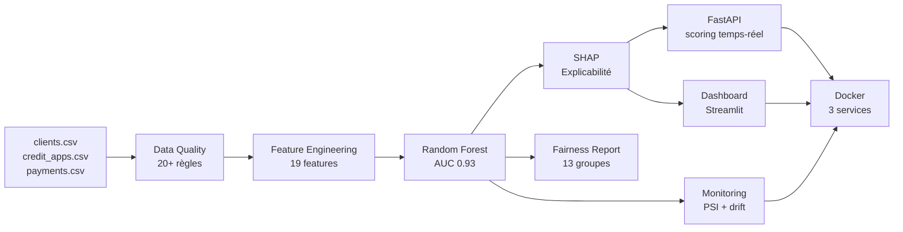

# Credit Risk Scoring & Portfolio Monitoring

> Système complet de scoring de risque crédit pour le secteur bancaire et assurantiel — du pipeline data à l'API REST en production, avec explicabilité SHAP et conformité réglementaire.


---

## Vue d'ensemble

Ce projet implémente un pipeline de scoring crédit end-to-end :

- **Génération** de données synthétiques réalistes (taux de défaut ~11%, contexte marocain)
- **Contrôle qualité** automatisé sur 20+ règles métier avec audit trail
- **Feature engineering** : 19 features incluant ratios financiers et historique de paiement
- **Modélisation** : Random Forest avec AUC 0.93 et Recall 0.90
- **Explicabilité SHAP** par dossier (conformité RGPD Art. 22 / EBA)
- **Rapport d'équité** (fairness testing sur 13 groupes — secteur, âge)
- **API REST** temps-réel avec FastAPI (scoring < 200ms)
- **Dashboard** Streamlit 5 pages pour la Direction des Risques
- **Monitoring** mensuel : PSI, drift de performance, distribution des classes
- **Dockerisation** complète en 3 services (pipeline / API / dashboard)
- **38 tests unitaires** — 0 échec

---

## Architecture

```
┌─────────────┐    ┌──────────────┐    ┌────────────────┐
│  DATA LAYER │ →  │ DATA QUALITY │ →  │    FEATURES    │
│  3 CSV raw  │    │  20+ règles  │    │   19 features  │
└─────────────┘    └──────────────┘    └────────────────┘
                                                ↓
┌─────────────┐    ┌──────────────┐    ┌────────────────┐
│   OUTPUTS   │ ←  │  ML MODEL    │ ←  │  AUDIT TRAIL   │
│ API/Dash/DK │    │  RF AUC 0.93 │    │  SHAP/Fairness │
└─────────────┘    └──────────────┘    └────────────────┘
```



---

## Structure du projet

```
.
├── src/
│   ├── config.py            # Chemins, seuils de risque, helpers
│   ├── data_generation.py   # Génération de données synthétiques
│   ├── data_quality.py      # Contrôles qualité + audit trail
│   ├── preprocessing.py     # Feature engineering (19 features)
│   ├── train_model.py       # Entraînement + rapport d'équité
│   ├── score_clients.py     # Scoring batch + SHAP + audit
│   ├── monitoring.py        # Monitoring mensuel (PSI, drift)
│   ├── api.py               # API REST FastAPI
│   └── run_pipeline.py      # Orchestration complète
├── dashboard/
│   └── app.py               # Dashboard Streamlit 5 pages
├── tests/
│   ├── test_config.py       # Tests classification risque
│   ├── test_data_generation.py
│   ├── test_preprocessing.py
│   └── test_api.py
├── sql/
│   ├── create_tables.sql    # Schéma SQL (6 tables)
│   └── kpi_queries.sql      # Requêtes KPI métier
├── docs/
│   ├── architecture.md
│   ├── business_explanation.md
│   ├── data_dictionary.md
│   └── model_card.md
├── data/
│   └── sample/              # 100 lignes d'exemple (versionnées)
├── Dockerfile
├── docker-compose.yml
└── requirements.txt
```

---

## Démarrage rapide

### Option 1 — Docker (recommandé)

```bash
# Lance le pipeline + API + Dashboard en une commande
docker compose up --build

# API REST  →  http://localhost:8000
# Swagger   →  http://localhost:8000/docs
# Dashboard →  http://localhost:8501
```

### Option 2 — Local

```bash
# Installer les dépendances
pip install -r requirements.txt

# Lancer le pipeline complet (données → modèle → scoring)
python -m src.run_pipeline

# Lancer l'API temps-réel
uvicorn src.api:app --reload --port 8000

# Lancer le dashboard
streamlit run dashboard/app.py
```

### Lancer les tests

```bash
pytest tests/ -v
# 38 passed ✓
```

---

## API REST — Endpoints

| Méthode | Endpoint | Description |
|---------|----------|-------------|
| `GET` | `/health` | Statut de l'API et du modèle |
| `POST` | `/score` | Scorer un dossier en temps-réel |
| `GET` | `/score/{credit_id}` | Récupérer un score batch existant |
| `GET` | `/portfolio/summary` | Résumé du portefeuille |
| `GET` | `/model/info` | Métadonnées + fairness report |

**Exemple de réponse `/score` :**

```json
{
  "request_id": "bfb73b05-db0a-4c5a-b0f5-5872f51e0bd0",
  "client_id": "C00099",
  "probability_default": 0.741,
  "risk_class": "Critique",
  "recommendation": "Escalade risque prioritaire",
  "top_risk_factors": [
    { "facteur": "nombre_retards_12m", "impact_shap": 0.1476, "sens": "hausse_risque" },
    { "facteur": "nb_impayes",         "impact_shap": 0.0834, "sens": "hausse_risque" },
    { "facteur": "taux_endettement",   "impact_shap": 0.0521, "sens": "hausse_risque" }
  ],
  "model_version": "credit-risk-v1.0",
  "scored_at": "2026-05-17T14:24:43Z",
  "shap_available": true
}
```

---

## Classes de risque

| Probabilité de défaut | Classe | Action recommandée |
|-----------------------|--------|-------------------|
| `< 10%` | **Faible** | Suivi standard |
| `10% – 25%` | **Moyen** | Dossier à surveiller |
| `25% – 50%` | **Élevé** | Contrôle manuel recommandé |
| `≥ 50%` | **Critique** | Escalade risque prioritaire |

---

## Performances du modèle

| Métrique | Logistic Regression | Random Forest (sélectionné) |
|----------|--------------------|-----------------------------|
| AUC | 0.947 | **0.933** |
| Recall | 0.946 | **0.900** |
| F1-Score | 0.756 | **0.737** |
| PR-AUC | 0.917 | **0.921** |

> Le Random Forest est sélectionné sur l'AUC. Le seuil de décision est fixé à 0.25 pour maximiser le recall (détecter un maximum de vrais défauts).

---

## Conformité réglementaire

Ce projet intègre dès la V1 les exigences réglementaires du secteur bancaire européen :

- **RGPD Article 22** — Explicabilité SHAP par décision (droit à l'explication)
- **EBA Guidelines on ML** — Audit trail complet, monitoring PSI, rapport d'équité
- **Bâle III / IFRS 9** — PD calculée individuellement par dossier

---

## Stack technique

| Catégorie | Technologies |
|-----------|-------------|
| Data & ML | `pandas` `numpy` `scikit-learn` `joblib` |
| Explicabilité | `shap` |
| API | `fastapi` `uvicorn` `pydantic` |
| Dashboard | `streamlit` `plotly` |
| Tests | `pytest` `httpx` |
| Infra | `docker` `docker-compose` |

---

## Limites

Ce projet est un **démonstrateur portfolio**. Les données sont synthétiques, générées localement. Le modèle ne doit pas être utilisé pour des décisions automatiques réelles. Toute décision de crédit doit rester soumise à validation humaine.

---

## Auteur

OUCHCHEN OMAR - ouchcheno@gmailcom
